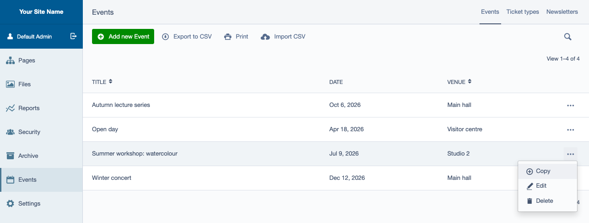
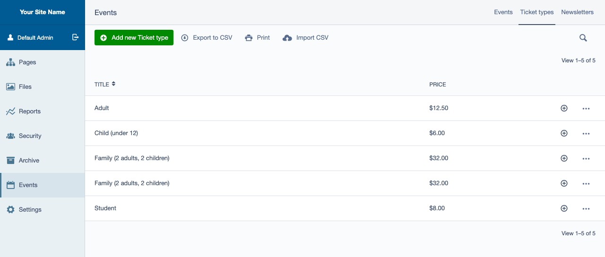
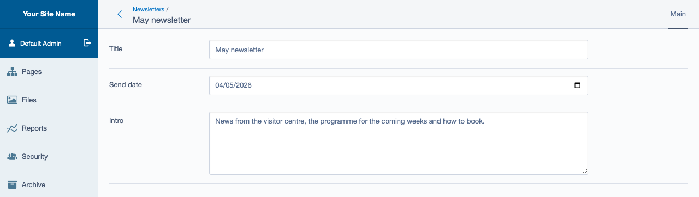

# Copy button for Silverstripe GridFields

Give every row of a GridField a Copy action: one click duplicates the record, and the copy shows up
in the list right away, or opens straight in its edit form. Put it in the row's action menu or show
it as an icon button. For Silverstripe 5 and 6.



*Maintained by [Restruct](https://github.com/restruct). If this module saves you time, you can
[support ongoing maintenance](https://github.com/sponsors/restruct).*

## A GridField row cannot be copied out of the box

Silverstripe can duplicate a record: `DataObject::duplicate()` does it, relations included where the
model asks for that. The CMS uses it for pages, in the site tree. A GridField, though, has no copy
action: the core row actions view, edit, delete or unlink a record, but none copies it. So an editor who needs a second
event, ticket type or newsletter much like an existing one starts from an empty form and types it
all in again.

This module adds that missing action:

- **Copy in the row's action menu** (the "..." dropdown), next to Edit and Delete, or as an **icon
  button** in the Actions column
- **The copy is written at once** and the GridField re-renders with it in the list
- **Optionally opens the copy's edit form** straight after copying
- **Only offered to users who may create the record** (`canCreate()`), and only for records in the
  GridField's own list

## Copy a row in one click

### In the action menu, or as a button

The component is `Unisolutions\GridField\CopyButton`. Add it to a GridField's config:

```php
use SilverStripe\Forms\GridField\GridFieldEditButton;
use Unisolutions\GridField\CopyButton;

// As an item in the row's action menu (the "..." dropdown) - the default:
$config->addComponent(CopyButton::create());

// Or as a button in the Actions column, placed before the edit button:
$config->addComponent(CopyButton::create(true), GridFieldEditButton::class);
```

`CopyButton::create()` and `new CopyButton()` both work from 3.0 (2.x only supported `new`).
The one constructor argument is `$useAsColumn` (default `false`): `false` puts "Copy" in the row's
action menu, `true` renders an icon button in the Actions column instead.



Pass the class name, not a short string, as the second `addComponent()` argument: GridFieldConfig
places the component before the first existing component that is an `instanceof` it, and silently
appends it at the end when nothing matches.

In a ModelAdmin, the place to do this is `getGridFieldConfig()` (or the `updateGridFieldConfig`
extension hook):

```php
use SilverStripe\Forms\GridField\GridFieldConfig;
use SilverStripe\Forms\GridField\GridFieldEditButton;
use Unisolutions\GridField\CopyButton;

class MyAdmin extends ModelAdmin
{
    protected function getGridFieldConfig(): GridFieldConfig
    {
        $config = parent::getGridFieldConfig();
        $config->addComponent(CopyButton::create(), GridFieldEditButton::class);
        return $config;
    }
}
```

### What a copy does

Clicking Copy calls `DataObject::duplicate()` on the record and writes the copy; the GridField then
re-renders with the copy in the list. The copy has the same field values as its original, title
included. No edit form is opened, unless you turn on
[open after copy](#open-the-copy-after-copying).

* **Relations are copied only where the model says so.** `duplicate()` follows the model's
  `cascade_duplicates` config; see
  [cascading duplications](https://docs.silverstripe.org/en/6/developer_guides/model/relations/#cascading-duplications).
* **Only records in the GridField's own list** can be copied: the record is looked up in that list,
  so a request for any other ID does nothing.
* **Permissions:** the button (column mode) or menu item (menu mode) is only shown to users for whom
  the record's `canCreate()` is true. A copy request from anyone else is refused with a
  `ValidationException` ("No create permissions") and nothing is written.

To act on the copy - say, to clear some relations, or to mark its title as a copy - implement
`onAfterDuplicate()` on the model or in an extension. It runs on the **copy**, after it was written:

```php
use SilverStripe\Core\Extension;

class SomeObjectExtension extends Extension
{
    public function onAfterDuplicate($original, $doWrite, $relations)
    {
        $this->getOwner()->Members()->removeAll();
    }
}
```

### Open the copy after copying

From 3.1, the button can open the copy's edit form straight away instead of re-rendering the list.
It is off by default:

```php
use SilverStripe\Forms\GridField\GridFieldEditButton;
use Unisolutions\GridField\CopyButton;

$config->addComponent(CopyButton::create()->setOpenAfterCopy(true), GridFieldEditButton::class);
```



The copy opens in the GridField's own detail form (`GridFieldDetailForm`), at the same URL the row's
edit button links to. That works for a GridField in a ModelAdmin and for one nested in a record's
edit form. In the CMS the redirect is answered with an `X-ControllerURL` header, and the admin loads
the edit form into the panel; outside the CMS it is a normal 302 redirect.

When the GridField cannot open the copy, the button falls back to re-rendering the list, without an
error:

* the GridField has no `GridFieldDetailForm` (for example `GridFieldConfig_Base`), or
* the copy is not in the GridField's list. `duplicate()` does not add the copy to a `many_many`
  list, or to a list filtered on something the copy does not match; a `has_many` list keeps it,
  because the copy keeps the parent's ID.

This replaces redirecting from the model's `onAfterDuplicate()`, which fires on every
`duplicate()` call, not only on a click of this button.

## Requirements

* Silverstripe 5 or 6 (`silverstripe/framework`)
* PHP 8.1 or newer (Silverstripe 6 itself needs 8.3)

## Installation

```
composer require restruct/silverstripe-copybutton
```

## Version compatibility

| Branch | Module version | Silverstripe | PHP |
|--------|----------------|--------------|-----|
| `main` | `3.x` | `^5 \|\| ^6` | `^8.1` |
| `v2` | `2.0.x` | `^4 \|\| ^5 \|\| ^6` (see note) | not declared |
| `1`, `1.0` | `1.x` | `^3` | not declared |

`2.0.1` declares Silverstripe 4, 5 and 6 but throws a Silverstripe 6-only exception class when a
user without create permission triggers a copy, so on 4 and 5 that path fatals (issue #3). `3.x`
and the `2.0.2` hotfix fix it. Silverstripe 4 reached end of life in April 2025 and is no longer supported or tested here;
projects still on it should stay on `2.0.x`.

`main` is the maintained line: it supports every Silverstripe version this module still targets.
The `v2` branch exists only for hotfixes to projects that stay on `^2.0` (such as `2.0.2`).

**`composer.json` is the source of truth** for exact constraints; this table is a quick reference.

Upgrading from 2.x: see [UPGRADING.md](UPGRADING.md). What changed in each release:
[CHANGELOG.md](CHANGELOG.md).

## Configuration

The module's only configuration adds its stylesheet to the CMS (it draws the column-mode icon
button):

```yaml
SilverStripe\Admin\LeftAndMain:
  extra_requirements_css:
    - "restruct/silverstripe-copybutton:css/GridFieldCopyButton.css"
```

Labels are translatable under `GridAction.Copy`, `GridAction.COPY_DESCRIPTION` and
`GridFieldAction_Copy.CreatePermissionsFailure` (see `lang/`).

## Running the tests

The module cannot be tested on its own: it needs a host Silverstripe project. Require it there
through a Composer **path repository with `symlink: true`** - `/tests` is `export-ignore`, so a dist
or mirrored install contains no tests - add `"Unisolutions\\Tests\\":
"vendor/restruct/silverstripe-copybutton/tests/"` to the host's `autoload-dev`, then:

```bash
# Silverstripe 5 (PHPUnit 9) - the path must come before flush=1
vendor/bin/phpunit vendor/restruct/silverstripe-copybutton/tests flush=1

# Silverstripe 6 (PHPUnit 11) - a flush=1 argument is ignored, use the env var
SS_PHPUNIT_FLUSH=1 vendor/bin/phpunit vendor/restruct/silverstripe-copybutton/tests
```

CI runs the same suite against Silverstripe 5 and 6 on pushes to `main` and on pull requests; see `.github/workflows/ci.yml`.

Playwright browser tests in `tests/browser/` click the copy button in a real CMS, on Silverstripe 5
and 6, in CI (`.github/workflows/browser-tests.yml`). The screenshots in this README are generated
the same way, from neutral demo content; see
[tests/browser/screenshots/README.md](tests/browser/screenshots/README.md) to regenerate them.

## Relation to dhensby/silverstripe-copybutton

This package `replace`s `dhensby/silverstripe-copybutton` (and `unisolutions/silverstripe-copybutton`):
all three ship the same class, so only one of them can be installed. Upstream publishes its own
Silverstripe 6-only 3.0.0; this package's 3.x covers Silverstripe 5 and 6 and differs in behaviour
(see [CHANGELOG.md](CHANGELOG.md)).

## Original author

Elvinas Liutkevičius <elvinas (at) unisolutions (dot) eu>
(Forked from dhensby's SS4-updated fork for quick maintenance & updates/tags)

## Licence

BSD-3-Clause, see [LICENSE](LICENSE).
